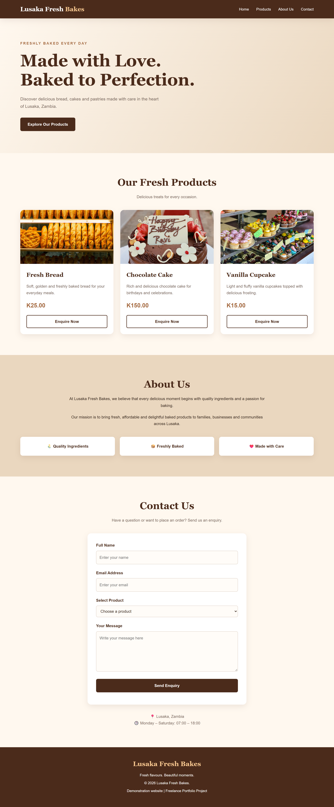
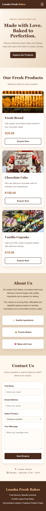


# Lusaka Fresh Bakes

A modern, responsive bakery website developed as a
freelance web development portfolio project.

## Project Overview

Lusaka Fresh Bakes is a demonstration website for a
fictional bakery based in Lusaka, Zambia.

The website showcases bakery products, provides business
information and includes an interactive customer enquiry form.

## Project Objectives

- Develop a professional business website.
- Implement responsive web design.
- Create an interactive user interface.
- Demonstrate frontend development skills.
- Build a freelance-ready portfolio project.

## Technologies Used

- HTML5
- CSS3
- JavaScript
- CSS Grid
- CSS Flexbox
- Visual Studio Code

## Website Features

- Responsive navigation bar
- Mobile hamburger menu
- Professional hero section
- Product photographs and pricing in ZMW
- Automatic product selection
- About Us section
- Customer enquiry form
- Client-side form validation
- Automatic copyright year
- Mobile and desktop layouts

## Featured Products

| Product | Price |
|---------|-------|
| Fresh Bread | K25.00 |
| Chocolate Cake | K150.00 |
| Vanilla Cupcake | K15.00 |

## Project Structure

Lusaka-Fresh-Bakes/
├── index.html
├── style.css
├── script.js
├── README.md
├── images/
│   ├── bread.webp
│   ├── cake.webp
│   └── cupcake.webp
└── screenshots/

## How to Run the Project

1. Download or clone the repository.
2. Open the project folder in Visual Studio Code.
3. Open index.html in a web browser.
4. Alternatively, use the Live Server extension.

No additional dependencies are required.

## Screenshots

### Desktop View

### Mobile View

## Skills Demonstrated

- Semantic HTML
- Responsive web development
- User interface design
- JavaScript DOM manipulation
- Event handling
- Form validation
- Software documentation
- Website debugging

## Future Improvements

- Backend integration
- Database integration
- Online ordering system
- Email enquiry functionality
- Product management dashboard

## Developer

Computer Science Student
Frontend Web Developer

## Business Working Hours

| Day | Working Hours |
|-----|---------------|
| Sunday - Thursday | 07:00 - 18:00 hrs |
| Friday | 07:00 - 16:00 hrs |
| Saturday | Closed |

## Disclaimer

This is a fictional business website created for educational
and freelance portfolio purposes.

The enquiry form demonstrates frontend functionality.
It does not transmit or store customer information.

Product prices and business information are illustrative.

## Project Status

Frontend development completed.
Final testing and deployment pending.

